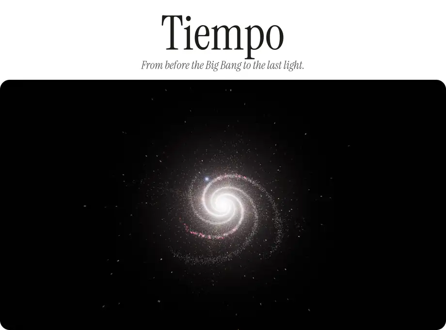
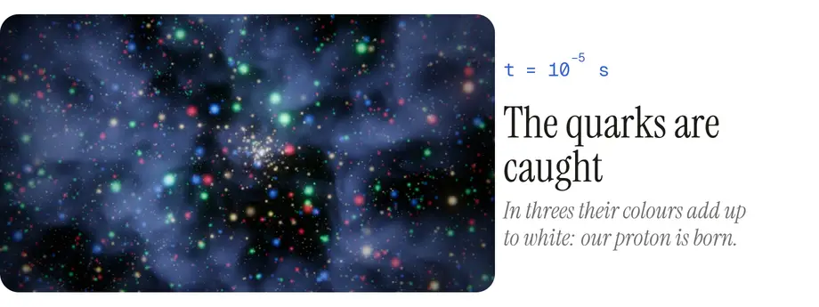
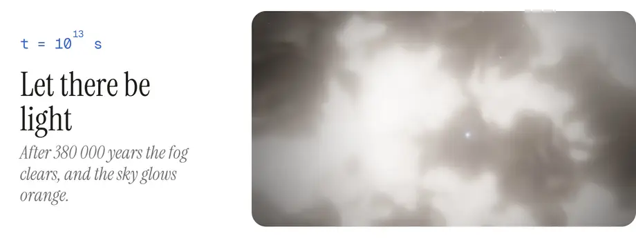
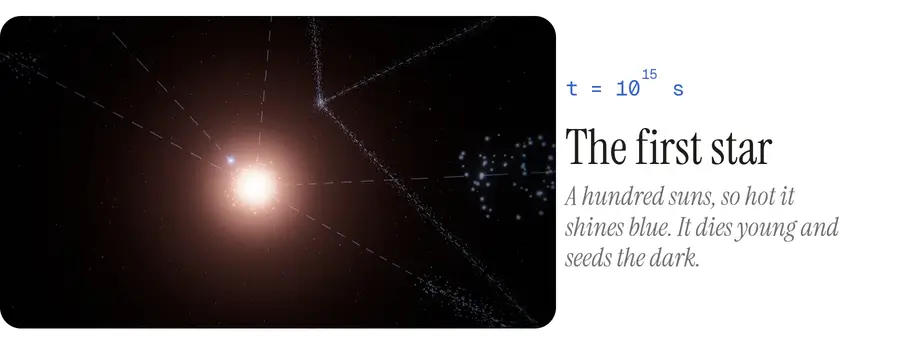
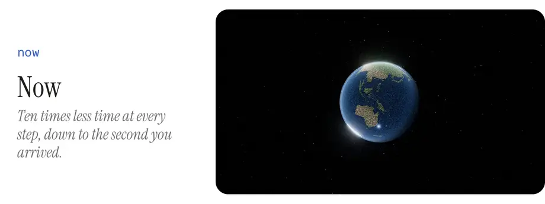
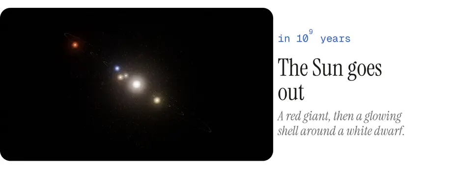
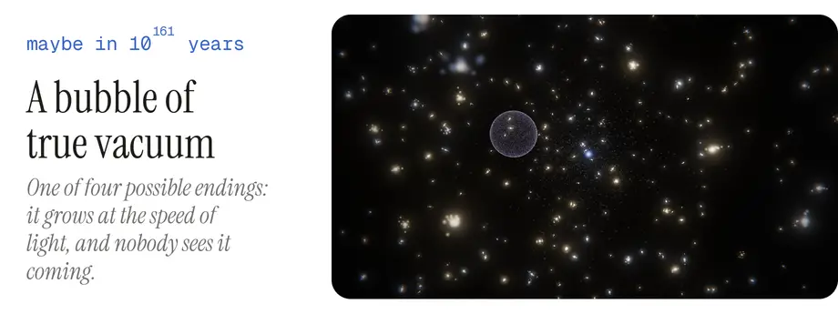

  <a href="https://drayzu.github.io/Tiempo/"><picture><source media="(prefers-color-scheme: dark)" type="image/avif" srcset="docs/media/cover-dark.avif"><source media="(prefers-color-scheme: dark)" srcset="docs/media/cover-dark.webp"><source type="image/avif" srcset="docs/media/cover-light.avif"></picture></a>

  <picture><source media="(prefers-color-scheme: dark)" type="image/avif" srcset="docs/media/quarks-dark.avif"><source media="(prefers-color-scheme: dark)" srcset="docs/media/quarks-dark.webp"><source type="image/avif" srcset="docs/media/quarks-light.avif"></picture>

  <picture><source media="(prefers-color-scheme: dark)" type="image/avif" srcset="docs/media/light-dark.avif"><source media="(prefers-color-scheme: dark)" srcset="docs/media/light-dark.webp"><source type="image/avif" srcset="docs/media/light-light.avif"></picture>

  <picture><source media="(prefers-color-scheme: dark)" type="image/avif" srcset="docs/media/star-dark.avif"><source media="(prefers-color-scheme: dark)" srcset="docs/media/star-dark.webp"><source type="image/avif" srcset="docs/media/star-light.avif"></picture>

  <picture><source media="(prefers-color-scheme: dark)" type="image/avif" srcset="docs/media/now-dark.avif"><source media="(prefers-color-scheme: dark)" srcset="docs/media/now-dark.webp"><source type="image/avif" srcset="docs/media/now-light.avif"></picture>

  <picture><source media="(prefers-color-scheme: dark)" type="image/avif" srcset="docs/media/sun-dark.avif"><source media="(prefers-color-scheme: dark)" srcset="docs/media/sun-dark.webp"><source type="image/avif" srcset="docs/media/sun-light.avif"></picture>

  <picture><source media="(prefers-color-scheme: dark)" type="image/avif" srcset="docs/media/vacuum-dark.avif"><source media="(prefers-color-scheme: dark)" srcset="docs/media/vacuum-dark.webp"><source type="image/avif" srcset="docs/media/vacuum-light.avif"></picture>

  <a href="https://drayzu.github.io/Tiempo/"><picture><source media="(prefers-color-scheme: dark)" srcset="docs/media/enter-dark.svg"></picture></a>

 

How it's made

 

- The second piece of Horizontes (Espacio · Tiempo · Destino · Infinito): one scroll, about ten minutes, through 23 eras and some 150 orders of magnitude of time, from the Planck epoch to the last light, with four possible endings (cold, Big Rip, Big Crunch, vacuum decay).
- Each era runs in its own units, anchored in the one before, and the clocks follow a real ΛCDM cosmology (Planck 2018). One proton is followed the whole way, from the quarks to the water in your body.
- Black holes are ray traced, with their shadow, photon ring and lensed disk. The background is the temperature of the universe, Planck's law through the CIE colour-matching functions: white-hot, then orange, then dark for almost all of time.
- Observed, theoretical and speculative are told apart at a glance: solid, dashed and dotted. A plate layer gives each era its numbers and sources, with a scale bar that stays true.
- English and Spanish. Keys: `A` autoplay, `I` plate, `L` language.
- TypeScript, Three.js and Vite, no framework. `npm install`, `npm run dev`; pushing to `main` deploys to GitHub Pages.

